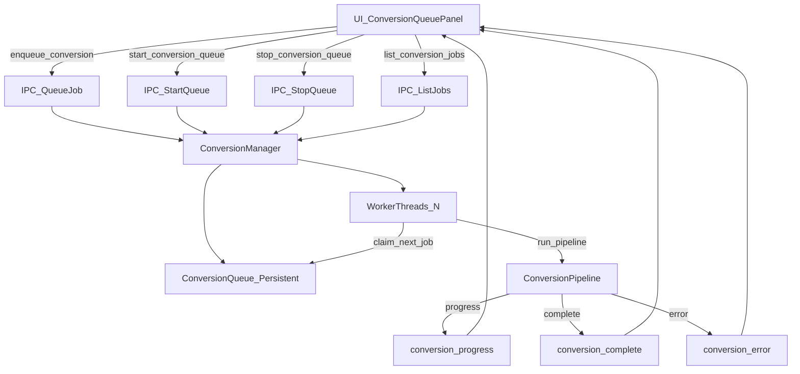

#

Audiobook conversion queuing (persistent + parallel)

## Goal

- **Queue multiple audiobooks** for conversion (each audiobook → one job/output file).

- **Run conversions in parallel** up to a configurable max concurrency.

- **Persist the queue to disk**, but **do not auto-start on app launch** (user explicitly starts the queue).

- **UI shows the queue** (queued/running/completed/failed), per-job progress, and per-job cancel.

## Key behavior (based on your answers)

- **Concurrency**: parallel processing (configurable max).

- **Persistence**: yes, save/load across restarts.

- **Startup**: queue loads on launch, but **processing stays stopped** until user clicks “Start queue”.

## Architecture

## Backend changes (Rust / Tauri)

### 1) Make the queue truly parallel-capable

- Update [`src-tauri/src/conversion/queue.rs`](/Users/anthonyizzo/Development/AudiobookConvertRs/src-tauri/src/conversion/queue.rs) to support **multiple active jobs** (not just a single `active: Option<ConversionJob>`).

- Replace single `active` with **`active: HashMap<String, ConversionJob>`** (keyed by `job_id`) or `Vec<ConversionJob>`.

- Add/rename an API like **`claim_next_job()`** that:

    - pops from `pending`, sets status → `running`, inserts into `active`, persists.

- Update status transitions (`complete_job`, `fail_job`, `cancel_job`, `update_job_progress`) to work with multiple active jobs.

- Persistence format change: adjust `QueueState` to store active IDs as a list (or store all jobs and simply treat any `running` as `queued` on load).

### 2) Add a queue runner/manager with manual start/stop

- Add a new module (recommended) [`src-tauri/src/conversion/runner.rs`](/Users/anthonyizzo/Development/AudiobookConvertRs/src-tauri/src/conversion/runner.rs) implementing a `ConversionManager` that:

- Owns a persistent `SharedQueue` (via `ConversionQueue::with_persistence`).

- Spawns **N worker threads** when started.

- Uses a `parking_lot::Condvar` + `AtomicBool` stop flag so workers sleep when idle and wake on enqueue.

- Each worker loop:

    - waits for work

    - `claim_next_job()`

    - runs [`src-tauri/src/conversion/pipeline.rs`](/Users/anthonyizzo/Development/AudiobookConvertRs/src-tauri/src/conversion/pipeline.rs)

    - updates queue job progress/status

    - emits events via `AppHandle.emit`.

- Does **not** start automatically on app launch.

- Export the new module from [`src-tauri/src/conversion/mod.rs`](/Users/anthonyizzo/Development/AudiobookConvertRs/src-tauri/src/conversion/mod.rs).

### 3) IPC commands for queue control + querying

- Refactor [`src-tauri/src/commands/conversion.rs`](/Users/anthonyizzo/Development/AudiobookConvertRs/src-tauri/src/commands/conversion.rs):

- Change `start_conversion` to **enqueue only** (or add a new `enqueue_conversion` and keep `start_conversion` as a backwards-compatible alias).

- Add commands:

    - `start_conversion_queue(max_concurrent: u8)`

    - `stop_conversion_queue()`

    - `list_conversion_jobs() -> Vec<ConversionJob>`

    - (optional) `remove_conversion_job(job_id)` and `clear_completed_jobs()`

- Update `cancel_conversion` and `get_conversion_status` to use the queue as the source of truth.

### 4) Register and manage the conversion manager state

- Update [`src-tauri/src/main.rs`](/Users/anthonyizzo/Development/AudiobookConvertRs/src-tauri/src/main.rs):

- `.manage(ConversionManager::new(...))` so commands can access it.

- Initialize persistence path using `UserSettings::config_dir()` (or a Tauri app data dir) and store queue state as something like `conversion_queue.json`.

### 5) Events

- Reuse existing event names in [`src-tauri/src/events.rs`](/Users/anthonyizzo/Development/AudiobookConvertRs/src-tauri/src/events.rs):

- `conversion_progress`, `conversion_complete`, `conversion_error` already support multiple jobs (keyed by `job_id`).

- (Optional) add `conversion_queue_changed` for “job enqueued/cancelled/removed” updates; otherwise the UI can refresh via `list_conversion_jobs()` after actions.

## Frontend changes (React)

### 1) Add queue APIs

- Extend [`src-ui/src/api/conversion.ts`](/Users/anthonyizzo/Development/AudiobookConvertRs/src-ui/src/api/conversion.ts) with wrappers for:

- `enqueueConversion` (or reuse `startConversion` but treat as enqueue)

- `startConversionQueue(maxConcurrent)`

- `stopConversionQueue()`
- `listConversionJobs()`

### 2) Build a queue UI

- Add a new component [`src-ui/src/components/ConversionQueuePanel.tsx`](/Users/anthonyizzo/Development/AudiobookConvertRs/src-ui/src/components/ConversionQueuePanel.tsx):

- **Queue active audiobook** (creates a job with chosen output path + settings).

- **Start queue / Stop queue** controls.

- **Concurrency input** (1–16) used when starting the queue.

- **Job list** with status chips + progress bars.

- **Cancel** button per job (queued or running).

- Listen to `conversion_progress/complete/error` events and update the matching job row.

- Update [`src-ui/src/App.tsx`](/Users/anthonyizzo/Development/AudiobookConvertRs/src-ui/src/App.tsx) to replace or augment the existing `ConversionPanel` with `ConversionQueuePanel`.

### 3) Initial queue load on app start

- On app mount (either in the new panel or via [`src-ui/src/context/AppContext.tsx`](/Users/anthonyizzo/Development/AudiobookConvertRs/src-ui/src/context/AppContext.tsx)), call `listConversionJobs()` so persisted jobs show up immediately.

## Tests & docs

- Add/extend unit tests for parallel queue semantics in [`src-tauri/src/conversion/queue.rs`](/Users/anthonyizzo/Development/AudiobookConvertRs/src-tauri/src/conversion/queue.rs):

- multiple active jobs

- cancel pending vs cancel running

- persistence load: `running` → `queued` (since we don’t auto-resume)

- Update [`API.md`](/Users/anthonyizzo/Development/AudiobookConvertRs/API.md) with the new queue commands and payloads.

## Acceptance checks

- Queue 3+ audiobooks, quit app, relaunch → queue is still visible and idle.

- Click “Start queue” with concurrency=2 → two jobs run in parallel, third starts when one finishes.

- Cancel a queued job → removed/marked cancelled without affecting running jobs.