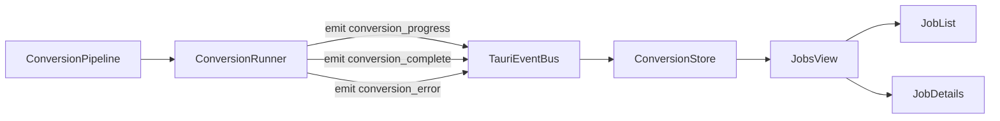

# Conversion Workflow UI Redesign (Jobs Dashboard)

## Goals

- **Make conversion feel first-class**: queue, running jobs, and history are a dedicated workspace (not buried in “Step 3”).
- **Better long-running feedback**: determinate progress (percent + ETA) when we can, and stage/step feedback when we can’t (consistent with NN/g + Apple HIG guidance for long waits).
- **Faster error recovery**: clear, actionable failure states (retry, copy details, reveal output).
- **Power-user ergonomics**: keyboard-first actions and a persistent “what’s happening now” status.

## Proposed UX (what changes for users)

### Jobs view (new, conversion-focused)

- **Split view layout**:
- **Left pane**: job list with filters (Running/Queued/Completed/Failed/Cancelled), search, and quick actions.
- **Right pane**: selected job details with progress, stages, settings summary, and actions.
- **Stage-aware progress**:
- Show **current stage** (Preparing/Encoding/Metadata/Chapters/Verifying/Finalizing) and a simple stepper.
- Show **percent + ETA** and **speed** when available.
- **Job actions**:
- Running: **Cancel**.
- Complete: **Reveal output** / **Copy path**.
- Error: **Retry** + **Copy error/details**.

### New job creation flow (replace “Configure” modal)

- A single **New Job drawer/dialog** that combines:
- **Preset selection** (optional)
- **Output path** + overwrite validation
- **Dry-run preview** (size/time/warnings)
- **Enqueue** (and optional auto-start)

### Persistent queue status

- Title bar (or a slim status pill) shows: **Queue state + active count + top ETA**, clickable to open Jobs.

## Data flow (frontend ↔ backend)

## Backend support required (small but important)

### 1) Emit richer progress payload

Today, the pipeline tracks stage/speed/file_index (`src-tauri/src/conversion/progress.rs` + `src-tauri/src/conversion/pipeline.rs`), but the emitted event drops that detail (`src-tauri/src/events.rs`).

- Update **event payload** to include:
- `file_index`
- `stage`
- `speed`
- `estimated_finish` (optional)
- Files:
- [src-tauri/src/events.rs](src-tauri/src/events.rs)
- [src-tauri/src/conversion/runner.rs](src-tauri/src/conversion/runner.rs)

### 2) Expose queue state (don’t infer it from job statuses)

- Add `get_conversion_queue_state()` returning { state, worker_count, active_jobs, pending_jobs }.
- Files:
- [src-tauri/src/commands/conversion.rs](src-tauri/src/commands/conversion.rs)

### 3) Add “retry” and “reveal output” actions

- `retry_conversion(job_id)` → requeue a terminal job using its stored audiobook/settings.
- Likely touches [src-tauri/src/commands/conversion.rs](src-tauri/src/commands/conversion.rs) and [src-tauri/src/conversion/queue.rs](src-tauri/src/conversion/queue.rs).
- `reveal_in_file_manager(path)` (or equivalent) for output.
- Add to [src-tauri/src/commands/files.rs](src-tauri/src/commands/files.rs) + TS wrapper in [src-ui/src/api/files.ts](src-ui/src/api/files.ts).

## Frontend implementation (where changes land)

### Navigation + view wiring

- Extend app views with `jobs`:
- [src-ui/src/context/AppContext.tsx](src-ui/src/context/AppContext.tsx)
- [src-ui/src/App.tsx](src-ui/src/App.tsx)
- [src-ui/src/components/Sidebar.tsx](src-ui/src/components/Sidebar.tsx)

### New Jobs UI (new components)

- [src-ui/src/components/ConversionJobsPage.tsx](src-ui/src/components/ConversionJobsPage.tsx) (new)
- [src-ui/src/components/conversion/JobList.tsx](src-ui/src/components/conversion/JobList.tsx) (new)
- [src-ui/src/components/conversion/JobDetails.tsx](src-ui/src/components/conversion/JobDetails.tsx) (new)
- [src-ui/src/components/conversion/NewJobDrawer.tsx](src-ui/src/components/conversion/NewJobDrawer.tsx) (new; integrates presets + dry run)

### Centralize conversion state + events

- Create a small “conversion store” (either inside AppContext or a new context) that:
- loads `listConversionJobs()` on entry
- listens once to `conversion_progress/complete/error`
- keeps `selectedJobId`
- uses a slower fallback refresh (e.g., 5–10s, not every 1s)

### Types alignment

- Add a `ConversionStage` union and expand `ConversionProgress` to match the new event payload:
- [src-ui/src/types/models.ts](src-ui/src/types/models.ts)

## Key files we’ll refactor (existing)

- Replace the current embedded queue UX:
- [src-ui/src/components/ConversionQueuePanel.tsx](src-ui/src/components/ConversionQueuePanel.tsx) (either slim it down to a “Jobs shortcut” or reuse parts inside JobList)
- Replace the basic modal:
- [src-ui/src/components/ConversionSettingsDialog.tsx](src-ui/src/components/ConversionSettingsDialog.tsx) (superseded by NewJobDrawer)