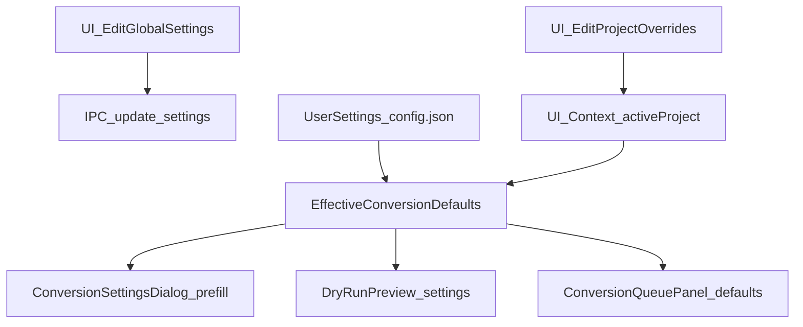

# Settings page (global + project conversion defaults)

## Outcomes

- A **Settings page/panel** reachable from the sidebar.
- Two scopes:
- **Global defaults** (persisted in `config.json` via Rust `UserSettings`).
- **Project overrides** (persisted inside the `.abcproj` project file).
- A single “effective defaults” computation used by:
- `ConversionSettingsDialog` (prefill)
- `ConversionQueuePanel` (queue concurrency default, plus job defaults)
- `DryRunPreview` (uses effective defaults)

## UX: Settings page structure

- **Navigation**: Sidebar “Settings” switches the main content from workflow → settings (no React Router required).
- **Page layout**:
- Header: “Settings” + **Back to app** button.
- Two cards/sections (or tabs):
    - **Global Defaults**
    - **Project Overrides** (only shown when a project is loaded)
- **Global Defaults fields (v1)**:
- **Conversion defaults**: bitrate, sample-rate (match source vs fixed), embed chapters, embed artwork, copy metadata, overwrite-by-default.
- **Output defaults**: default output directory (folder picker; empty means “same as input”).
- **Queue defaults**: default queue concurrency (1–16).
- **Artwork behavior**: auto-detect artwork, scan folder for cover images.
- **UI**: theme, “show advanced options”.
- **System/Debug**: log level (save + show “takes effect next launch”), FFmpeg status (detected/not detected + version/path).
- Buttons: **Save**, **Reset to defaults** (confirm), **Cancel** (discard local edits).
- **Project Overrides fields (v1)**:
- A project-level “conversion defaults” form (same set as global conversion defaults).
- Buttons: **Use global defaults** (clear overrides), **Apply to project** (updates in-memory project state; persisted next time the user saves the project).

## Data model + precedence

- **Precedence rule**: `effective = project_overrides (if present) over global_defaults`.
- Output path stays **per job**, but defaults provide:
- bitrate/sample-rate
- embed flags
- overwrite default
- default output directory to seed the output picker

## Backend work (Rust / Tauri)

### 1) Make `UserSettings` forward-compatible + add missing conversion-default flags

- Update [`/Users/anthonyizzo/Development/AudiobookConvertRs/src-tauri/src/config.rs`](/Users/anthonyizzo/Development/AudiobookConvertRs/src-tauri/src/config.rs):
- Add `#[serde(default)] `on `UserSettings` so old `config.json` continues to load after new fields are added.
- Add fields needed for conversion defaults parity:
    - `embed_artwork_by_default: bool`
    - `overwrite_existing_by_default: bool`
- Keep existing fields as-is (bitrate/sample-rate/output dir/concurrency/etc.).
- Extend `validate()` accordingly.

### 2) Expose Settings commands needed by the UI

- Update [`/Users/anthonyizzo/Development/AudiobookConvertRs/src-tauri/src/commands/settings.rs`](/Users/anthonyizzo/Development/AudiobookConvertRs/src-tauri/src/commands/settings.rs):
- Ensure `reset_settings` is available from the UI (already implemented, just not registered).
- Add a UI-friendly FFmpeg info command (recommended): `get_ffmpeg_info() -> Option<SerializableFFmpegInfo>` returning at least `{ path, version, supports_libfdk_aac }`.
- Update [`/Users/anthonyizzo/Development/AudiobookConvertRs/src-tauri/src/main.rs`](/Users/anthonyizzo/Development/AudiobookConvertRs/src-tauri/src/main.rs):
- Register `reset_settings` and any new FFmpeg-info command.

### 3) Persist project-scoped conversion defaults

- Add a new shared model in [`/Users/anthonyizzo/Development/AudiobookConvertRs/src-tauri/src/models.rs`](/Users/anthonyizzo/Development/AudiobookConvertRs/src-tauri/src/models.rs):
- `ConversionDefaults` (same fields as conversion-related defaults, **no output_path**).
- Helper: `ConversionDefaults::to_settings(output_path) -> ConversionSettings`.
- Update [`/Users/anthonyizzo/Development/AudiobookConvertRs/src-tauri/src/project.rs`](/Users/anthonyizzo/Development/AudiobookConvertRs/src-tauri/src/project.rs):
- Add `conversion_defaults: Option<ConversionDefaults>` (new field; backwards-compatible because it’s optional).
- (Optional) If `conversion_settings` exists in old files, derive `conversion_defaults` during load/migrate.
- Update [`/Users/anthonyizzo/Development/AudiobookConvertRs/src-tauri/src/commands/project.rs`](/Users/anthonyizzo/Development/AudiobookConvertRs/src-tauri/src/commands/project.rs):
- Change `save_project` to accept `conversion_defaults: Option<ConversionDefaults>` from the frontend and write it into the project file.

## Frontend work (React / TypeScript)

### 1) Align TypeScript types to Rust JSON

- Update [`/Users/anthonyizzo/Development/AudiobookConvertRs/src-ui/src/types/models.ts`](/Users/anthonyizzo/Development/AudiobookConvertRs/src-ui/src/types/models.ts):
- Replace the current `UserSettings` interface with one matching Rust `UserSettings` fields (snake_case).
- Add `ConversionDefaults` type.
- Update `Project` type to include `conversion_defaults?: ConversionDefaults` (and keep `conversion_settings?` if still returned by backend).
- Fix `FFmpegInfo` type to match what backend actually returns (or rename to `FFmpegStatus/FFmpegInfo` and keep minimal fields).

### 2) Fix API wrappers used by Settings

- Update [`/Users/anthonyizzo/Development/AudiobookConvertRs/src-ui/src/api/settings.ts`](/Users/anthonyizzo/Development/AudiobookConvertRs/src-ui/src/api/settings.ts):
- Add `resetSettings()`.
- Fix `getFFmpegVersion()` return type (it currently promises `FFmpegInfo | null` but backend returns a `string`).
- Add `getFfmpegInfo()` if backend exposes it.
- Update [`/Users/anthonyizzo/Development/AudiobookConvertRs/src-ui/src/api/files.ts`](/Users/anthonyizzo/Development/AudiobookConvertRs/src-ui/src/api/files.ts):
- Fix `pickDirectory()` signature to match backend (`Promise<string | null>`).
- Update [`/Users/anthonyizzo/Development/AudiobookConvertRs/src-ui/src/api/project.ts`](/Users/anthonyizzo/Development/AudiobookConvertRs/src-ui/src/api/project.ts):
- Update `saveProject()` to pass `conversion_defaults` (from context) to `save_project`.

### 3) Add navigation state for “workflow vs settings page”

- Update [`/Users/anthonyizzo/Development/AudiobookConvertRs/src-ui/src/context/AppContext.tsx`](/Users/anthonyizzo/Development/AudiobookConvertRs/src-ui/src/context/AppContext.tsx):
- Add `view: 'workflow' | 'settings'` and setters.
- Store `activeProject` (or at least `activeProjectConversionDefaults`).
- Add a helper selector: `getEffectiveConversionDefaults()` (project overrides → global defaults).
- Update [`/Users/anthonyizzo/Development/AudiobookConvertRs/src-ui/src/components/Sidebar.tsx`](/Users/anthonyizzo/Development/AudiobookConvertRs/src-ui/src/components/Sidebar.tsx):
- Enable Settings nav item and switch view to `settings`.
- Update [`/Users/anthonyizzo/Development/AudiobookConvertRs/src-ui/src/App.tsx`](/Users/anthonyizzo/Development/AudiobookConvertRs/src-ui/src/App.tsx):
- Conditionally render workflow sections vs SettingsPage.

### 4) Implement the Settings page UI

- Add [`/Users/anthonyizzo/Development/AudiobookConvertRs/src-ui/src/components/SettingsPage.tsx`](/Users/anthonyizzo/Development/AudiobookConvertRs/src-ui/src/components/SettingsPage.tsx):
- Load initial state from context.
- Provide local “draft” objects for global/project edits.
- Validate client-side (range checks mirror Rust `validate()`).
- Save global via `SettingsApi.updateSettings(draft)`.
- Reset global via `SettingsApi.resetSettings()`.
- Apply project defaults by updating context’s active project state.
- Show FFmpeg status/version/path and a link/button to re-check.

### 5) Wire defaults into conversion UI

- Update [`/Users/anthonyizzo/Development/AudiobookConvertRs/src-ui/src/components/ConversionSettingsDialog.tsx`](/Users/anthonyizzo/Development/AudiobookConvertRs/src-ui/src/components/ConversionSettingsDialog.tsx):
- Accept `initialDefaults` prop (or read from context) so bitrate/flags start from effective defaults.
- Seed output picker with default output directory + suggested filename.
- Update [`/Users/anthonyizzo/Development/AudiobookConvertRs/src-ui/src/components/ConversionQueuePanel.tsx`](/Users/anthonyizzo/Development/AudiobookConvertRs/src-ui/src/components/ConversionQueuePanel.tsx):
- Initialize `maxConcurrent` from global settings `concurrent_jobs`.
- Update [`/Users/anthonyizzo/Development/AudiobookConvertRs/src-ui/src/components/DryRunPreview.tsx`](/Users/anthonyizzo/Development/AudiobookConvertRs/src-ui/src/components/DryRunPreview.tsx):
- Use effective defaults instead of hardcoded settings.

## Tests + docs (targeted)

- Backend tests:
- `UserSettings` serde backwards-compat (missing new fields) + validation.
- Project save/load roundtrip with `conversion_defaults`.
- Update [`/Users/anthonyizzo/Development/AudiobookConvertRs/API.md`](/Users/anthonyizzo/Development/AudiobookConvertRs/API.md) to match actual command names (`update_settings`, `reset_settings`) and settings schema.

## Acceptance checklist

- Sidebar “Settings” opens the Settings page and Back returns to workflow.
- Global defaults save and persist across restart.
- Project overrides load from `.abcproj` and override global defaults while that project is active.
- Conversion dialog and dry-run preview reflect effective defaults.