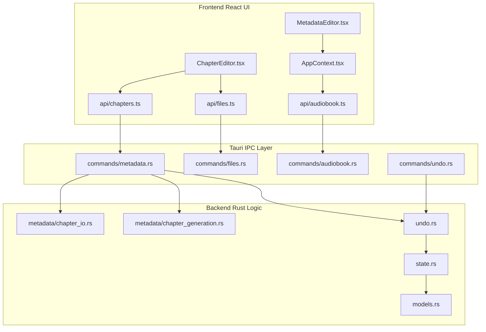
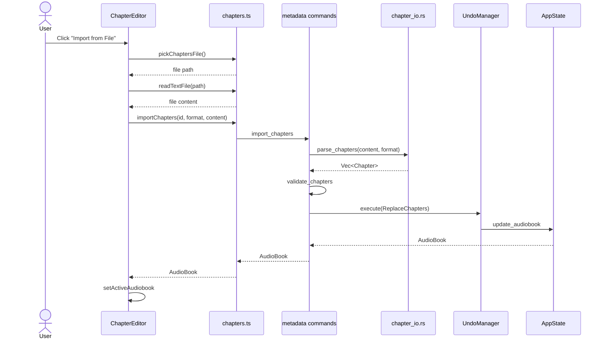
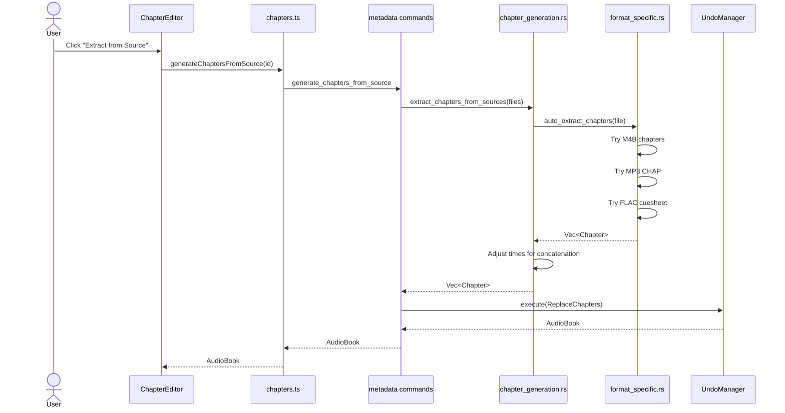
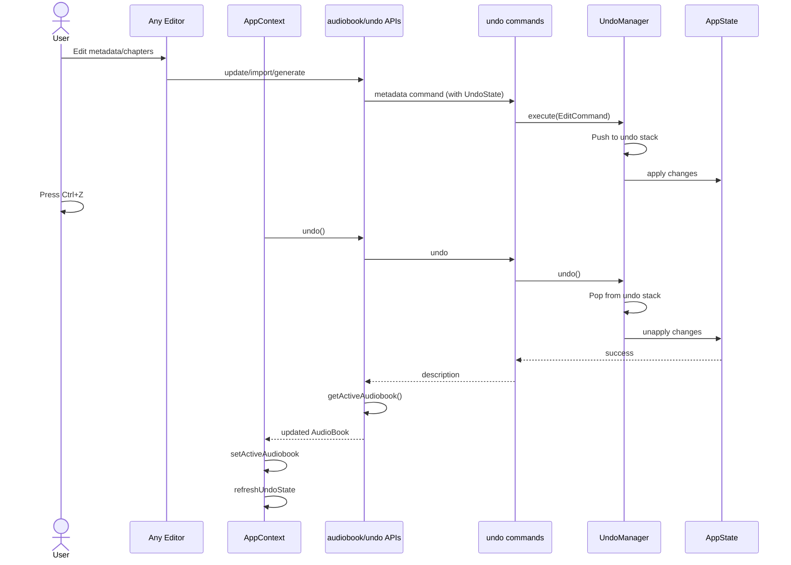

# Chapter & Metadata Editor Architecture

## System Overview



## Chapter Import/Export Flow



## Smart Generation Flow



## Undo/Redo Flow



## Key Design Decisions

### 1. Format Auto-Detection
- Import auto-detects format from file extension
- Supports both `.txt` (Audacity) and `.ffmeta` (FFmpeg) extensions
- CSV headers are optional (auto-detected)

### 2. Flexible Time Parsing
- Accepts multiple time formats: `HH:MM:SS`, `MM:SS`, or decimal seconds
- Converts all to milliseconds internally
- Graceful error handling with line numbers

### 3. Single Undo Step for Bulk Operations
- Chapter import = one undo operation
- Regex rename = one undo operation
- Generation = one undo operation
- Uses `ReplaceChapters` command to store old/new state

### 4. Validation at Multiple Layers
- Parse-time validation (format-specific)
- Pre-apply validation (overlap/duration checks)
- Save-time validation (metadata field limits)

### 5. Progressive Disclosure in UI
- Basic operations visible by default
- Advanced features (custom regex) in expandable sections
- Warnings shown inline when detected

## Data Models

### Chapter Structure
```rust
pub struct Chapter {
    pub index: usize,           // Zero-based position
    pub title: String,          // Display name
    pub start_time_ms: u64,     // Milliseconds from start
    pub end_time_ms: u64,       // Milliseconds from start
    pub auto_detected: bool,    // Source tracking
}
```

### Metadata Structure (Extended)
```rust
pub struct Metadata {
    // Core fields
    pub title: Option<String>,
    pub artist: Option<String>,
    pub narrator: Option<String>,
    
    // Series fields (NEW)
    pub series: Option<String>,
    pub series_index: Option<u32>,
    
    // Language (NEW)
    pub language: Option<String>,
    
    // Publishing
    pub publisher: Option<String>,
    pub copyright: Option<String>,
    
    // Indexing
    pub track_number: Option<u32>,
    pub total_tracks: Option<u32>,
    pub disc_number: Option<u32>,
    pub total_discs: Option<u32>,
    
    // Notes
    pub description: Option<String>,
    pub comments: Option<String>,
    
    // ... other fields
}
```

## Performance Characteristics

- **Import**: O(n) where n = lines in file
- **Export**: O(n) where n = chapters
- **Regex rename**: O(n*m) where n = chapters, m = title length
- **Extract from source**: O(n) where n = files (cached per file)
- **Undo/Redo**: O(1) stack operations + O(n) chapter copy

## Error Handling

### Parse Errors
- Invalid time values → validation error with line number
- Invalid format → descriptive error message
- Missing required fields → warning, skip line

### Runtime Errors
- Audiobook not found → user-friendly message
- File not readable → permission/not found error
- Regex invalid → pattern syntax error with description

### Recovery
- All operations are transactional (undo available)
- Failed imports don't corrupt existing chapters
- Export failures don't modify source data

## Future Enhancements

### Already Architected For
- Preview before import (UI state management ready)
- Batch chapter operations (undo system supports batching)
- Custom validation rules (validation layer is extensible)

### Easy to Add
- More export formats (JSON, YAML) - just add to `ChapterFormat` enum
- More regex presets - extend `get_regex_presets()`
- Inline editing - reuse existing `update_chapter` command
- Visual timeline - data model already has precise times

