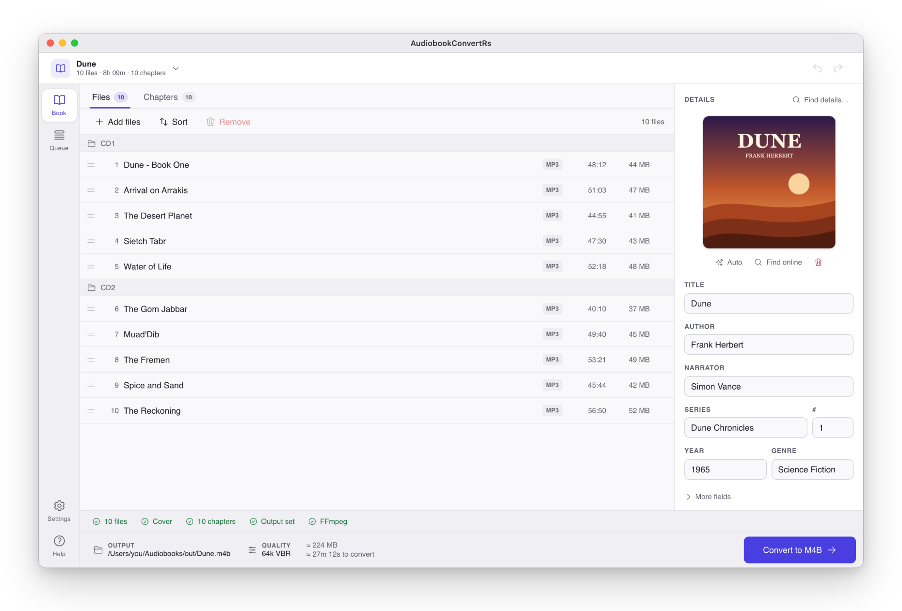
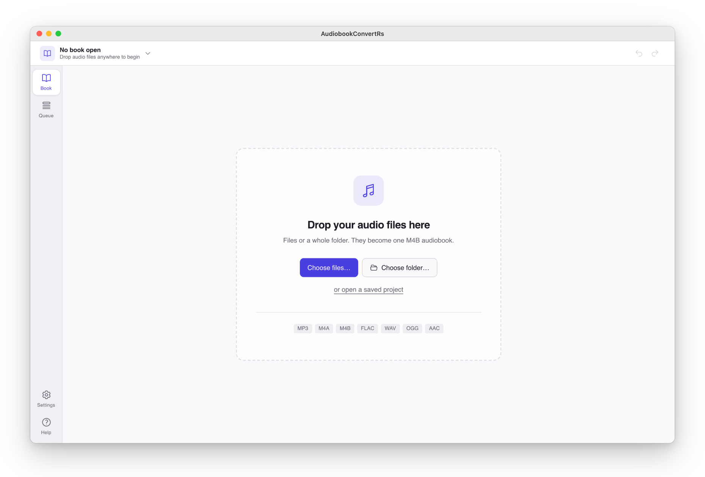
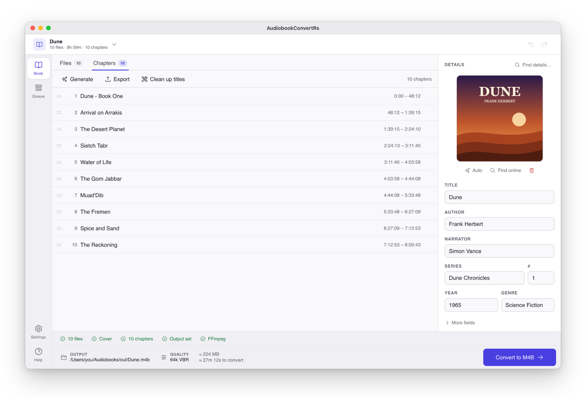
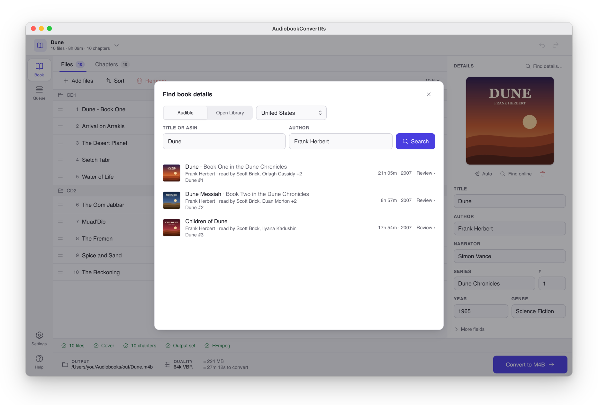
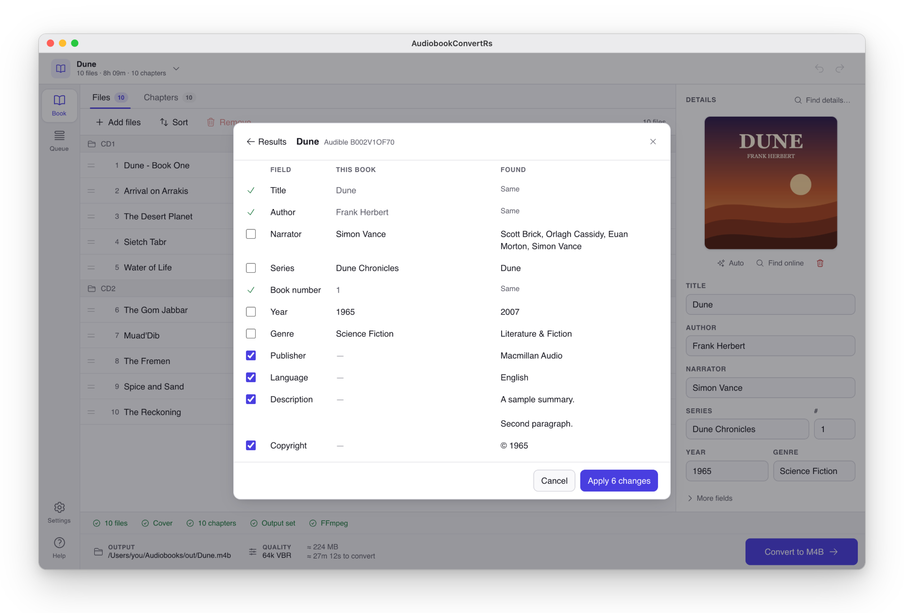
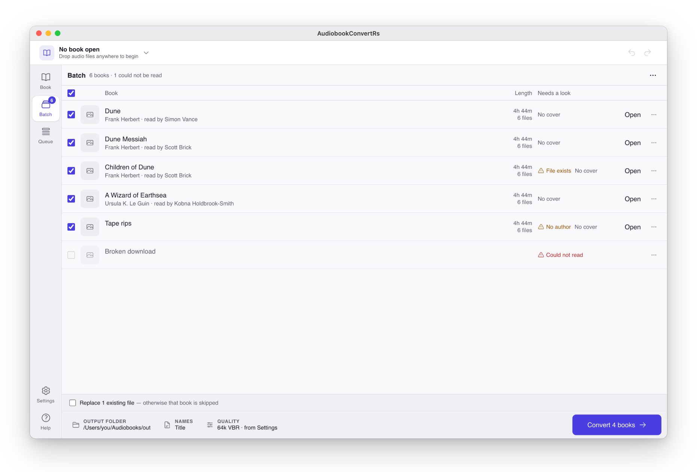
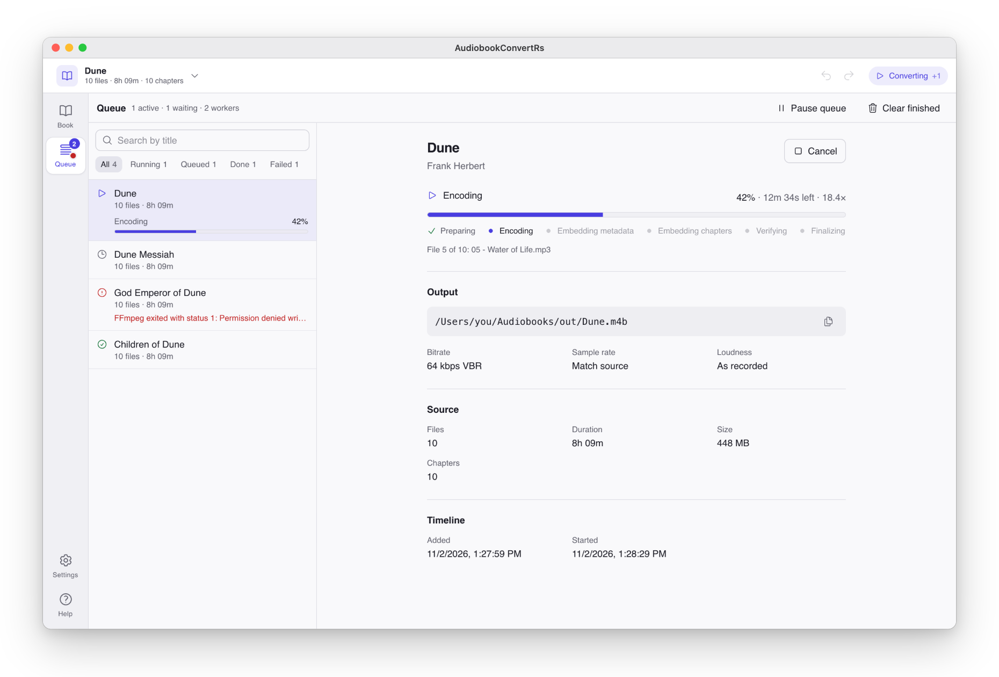
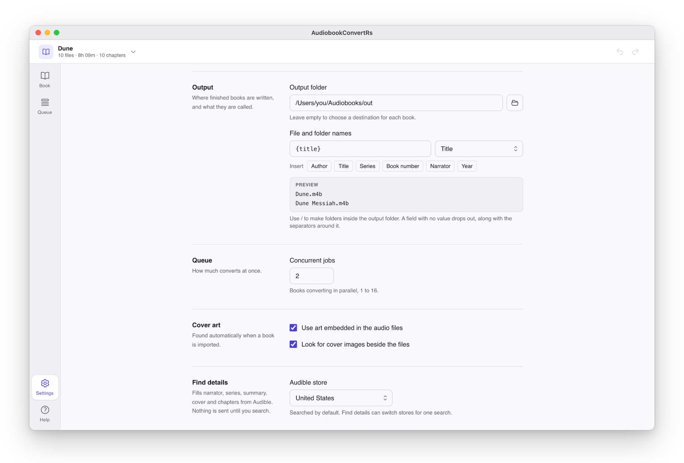
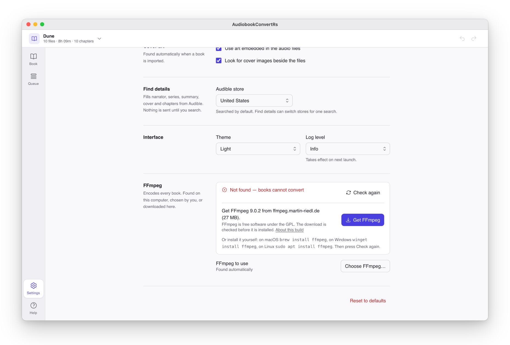

<p align="center">
  
</p>

<h1 align="center">AudiobookConvertRs</h1>

<p align="center">
  <strong>Turn a folder of MP3, FLAC or M4A files into one tagged, chaptered M4B audiobook.</strong><br>
  A desktop app for macOS, Windows and Linux, built with Rust and Tauri.
</p>

<p align="center">
  <a href="https://github.com/izzoa/AudiobookConvertRs/releases/latest"></a>
  <a href="https://github.com/izzoa/AudiobookConvertRs/actions/workflows/ci.yml"></a>
  
  <a href="LICENSE"></a>
</p>

<p align="center">
  <a href="#download">Download</a> ·
  <a href="#features">Features</a> ·
  <a href="#a-tour">Tour</a> ·
  <a href="#ffmpeg">FFmpeg</a> ·
  <a href="#building-from-source">Build</a> ·
  <a href="#contributing">Contribute</a>
</p>

<picture>
  <source media="(prefers-color-scheme: dark)" srcset="docs/screenshots/workbench-dark.png">
  
</picture>

> [!NOTE]
> AudiobookConvertRs is in early development. Expect rough edges, and please [report what you find](https://github.com/izzoa/AudiobookConvertRs/issues).

## Download

Get the latest version from the [Releases](https://github.com/izzoa/AudiobookConvertRs/releases) page.

| Platform | File | Notes |
|----------|------|-------|
| **macOS** | `AudiobookConvertRs_x.y.z_universal.dmg` | Runs natively on Apple Silicon and Intel. Signed and notarized, so it opens without a warning. |
| **Windows** | `AudiobookConvertRs_x.y.z_x64-setup.exe` | Not signed yet: SmartScreen shows "Windows protected your PC". Choose **More info → Run anyway**. |
| **Linux** | `audiobookconvert-rs_x.y.z_amd64.deb` | Ubuntu 22.04 or later and other Debian-based systems: `sudo apt install ./audiobookconvert-rs_x.y.z_amd64.deb`. FFmpeg is installed with it. |

Each release lists the SHA-256 of every file in `SHA256SUMS`.

Converting needs **FFmpeg**. You probably don't have to do anything: the app finds an installed copy, offers to download one on macOS and Windows, and the Linux package installs it. See [FFmpeg](#ffmpeg).

## Features

**Import**
- Drop files or a whole folder. Disc folders such as `CD1` and `CD2` keep their order.
- Drop a library and each book becomes its own entry in a **batch**, ready to review and convert together.
- Reads MP3, M4A, M4B, FLAC, WAV, OGG and AAC.
- Reads the tags already in your files, including narrator, series and series number, publisher, language and ASIN, from ID3, MP4 and Vorbis tags alike.
- Finds cover art embedded in the files or saved beside them.

**Edit**
- Title, author, narrator, series and book number (decimals such as `1.5` work), year, genre, publisher, language, copyright, description and ASIN.
- **Find details** searches Audible (10 stores) or Open Library. You review each found value next to your own before anything changes. Audible results bring the narrators, series, summary, cover and chapter titles, and chapters are fitted to your book by its length.
- Undo and redo for your edits, kept separately for each open book.
- Save a project and pick it up later.
- Play any file to check it before converting.

**Chapters**
- One chapter per file to start with.
- Or read the chapter marks inside the files (M4B and M4A chapters, MP3 chapter frames, FLAC cue sheets), import a CUE sheet, or import a chapter list (`.txt`, `.csv`, `.ffmeta`).
- Chapter titles and starts from **Find details**, even when your files are split differently from the Audible edition: each chapter goes to a nearby track start, to where the narrator announces it, or into a pause. The ones placed by a pause or an estimate are marked for you to check.
- **Chapters by ear**, with the optional speech model (57 MB, downloaded only when you ask): the app listens near each chapter for the narrator saying its title, such as "Chapter Four. Outlaws.", on this computer.
- Edit any chapter's start time, and play a chapter to check where it begins.
- Rename, reorder by dragging, and tidy titles in bulk with **Clean up titles**.
- Export the list as Audacity labels, FFmetadata or CSV.

**Convert**
- AAC in an M4B with chapters, cover and tags embedded. FFmpeg's `libfdk_aac` encoder is used when your FFmpeg has it.
- Quality presets (High 256 kbps, Medium 128 kbps, Low 64 kbps) or your own bitrate, sample rate and VBR or CBR.
- Optional loudness normalization.
- Name files and folders from a template such as `{author}/{series}/{title}`.
- A queue that converts several books at once (1 to 16), with progress, time left and speed, and a **Retry** for failed jobs.

## A tour

### Start with a folder

Drop audio files or a folder anywhere in the window, or choose them.

<picture>
  <source media="(prefers-color-scheme: dark)" srcset="docs/screenshots/empty-dark.png">
  
</picture>

### Everything about the book on one screen

The book's files sit in the middle and its cover and details on the right. The Convert bar along the bottom shows what is ready and what still needs a look, so the Convert button never scrolls out of reach. The **Chapters** tab works the same way.

<picture>
  <source media="(prefers-color-scheme: dark)" srcset="docs/screenshots/chapters-dark.png">
  
</picture>

### Find details online

Search Audible or Open Library by title, author or ASIN.

<picture>
  <source media="(prefers-color-scheme: dark)" srcset="docs/screenshots/find-details-dark.png">
  
</picture>

Then review what was found. Empty fields start ticked, values you already have start unticked, and identical ones say **Same**. **Apply** makes all the ticked changes as one undo step.

<picture>
  <source media="(prefers-color-scheme: dark)" srcset="docs/screenshots/find-details-review-dark.png">
  
</picture>

### Chapters placed by ear

When Audible's chapters do not line up with your files, for example when the book is one long MP3, each chapter is placed by the first of these that works:

1. A track start within 30 seconds of where the chapter is expected.
2. With the speech model, where the narrator announces the chapter's title, within 90 seconds. The chapter starts in the pause just before the announcement.
3. The longest pause within 30 seconds.
4. Where it is expected, from Audible's timings scaled to your book.

Chapters placed by 3 or 4 are marked in the review and in the Chapters tab, so you can play them and move a start if needed. On a 7-hour single-file book, the speech model placed 15 of 17 chapters on their announcements; without it, 13 went to a pause and 3 to an estimate.

Get the model from **Settings → Speech model**, or from the offer under the chapters in the review, which then fits the chapters again. It is OpenAI's Whisper base model (57 MB) from Hugging Face, run with [whisper.cpp](https://github.com/ggml-org/whisper.cpp). Its SHA-256 is checked before it is installed, and **Remove** deletes it. Listening happens on this computer; no audio is sent anywhere.

### Convert a whole library

Drop a folder of books and each one becomes a row in the batch, with anything that needs attention called out: a missing author, a file that already exists, a folder that could not be read.

<picture>
  <source media="(prefers-color-scheme: dark)" srcset="docs/screenshots/batch-dark.png">
  
</picture>

### Watch the queue

Every book you convert goes to the queue, where you can follow each stage, read the error of a failed job, retry it, or show the finished file in Finder or Explorer.

<picture>
  <source media="(prefers-color-scheme: dark)" srcset="docs/screenshots/queue-dark.png">
  
</picture>

### Name your files once

Settings holds the defaults for every new book, including the naming template, with a preview of where books will land.

<picture>
  <source media="(prefers-color-scheme: dark)" srcset="docs/screenshots/settings-output-dark.png">
  
</picture>

## FFmpeg

FFmpeg does the encoding. The app looks for it in this order:

1. The program you chose in **Settings → FFmpeg → Choose FFmpeg…**
2. An installed copy: the usual install folders (such as Homebrew's), then your `PATH`.
3. A copy the app downloaded.

If none is found, the Convert bar shows **No FFmpeg** and Convert is disabled. On macOS and Windows, **Get FFmpeg** in Settings downloads one fixed build (27 to 34 MB), checks its SHA-256 before installing it, and keeps it in the app's own data folder. **Remove** deletes it again. Nothing is downloaded until you click.

<picture>
  <source media="(prefers-color-scheme: dark)" srcset="docs/screenshots/get-ffmpeg-dark.png">
  
</picture>

You can also install it yourself:

<details>
<summary><strong>macOS</strong></summary>

```bash
brew install ffmpeg
```
</details>

<details>
<summary><strong>Windows</strong></summary>

```powershell
winget install ffmpeg
```

Or download it from [ffmpeg.org](https://ffmpeg.org/download.html), extract it to a folder such as `C:\ffmpeg`, and add its `bin` folder to your `PATH`.
</details>

<details>
<summary><strong>Linux</strong></summary>

```bash
sudo apt install ffmpeg   # Ubuntu, Debian
sudo dnf install ffmpeg   # Fedora
```
</details>

Then press **Check again** in Settings.

## Formats

| | |
|---|---|
| **Reads** | MP3, M4A, M4B, FLAC, WAV, OGG, AAC |
| **Writes** | M4B (AAC audio) |
| **Not supported** | WMA, Opus, and DRM-protected Audible files (AAX) |

## Keyboard shortcuts

| Action | macOS | Windows and Linux |
|--------|-------|-------------------|
| Undo | `⌘Z` | `Ctrl+Z` |
| Redo | `⇧⌘Z` | `Ctrl+Y` or `Ctrl+Shift+Z` |
| Save project | `⌘S` | `Ctrl+S` |
| Open project | `⌘O` | `Ctrl+O` |

## Where things are kept

Settings and the queue are saved in:

| Platform | Folder |
|----------|--------|
| macOS | `~/Library/Application Support/AudiobookConvertRs/` |
| Windows | `%APPDATA%\AudiobookConvertRs\` |
| Linux | `~/.config/AudiobookConvertRs/` |

A downloaded FFmpeg goes in the `ffmpeg` folder of the app's local data folder: the same folder as above on macOS, and `%LOCALAPPDATA%\AudiobookConvertRs\ffmpeg\` on Windows.

The speech model goes in the `speech` folder beside it: `~/Library/Application Support/AudiobookConvertRs/speech/` on macOS, `%LOCALAPPDATA%\AudiobookConvertRs\speech\` on Windows and `~/.local/share/AudiobookConvertRs/speech/` on Linux.

## Building from source

You need:
- [Rust](https://rustup.rs/) 1.88 or later
- [Node.js](https://nodejs.org/) 22 or later
- FFmpeg, installed or downloaded from the app's Settings
- CMake and Clang, to build whisper.cpp for the speech model: on macOS, Xcode's command line tools and `brew install cmake`; on Windows, CMake and LLVM
- On Linux, the WebKitGTK, ALSA and whisper.cpp build dependencies:
  ```bash
  sudo apt install libwebkit2gtk-4.1-dev build-essential curl wget file libxdo-dev libssl-dev libayatana-appindicator3-dev librsvg2-dev libasound2-dev cmake libclang-dev
  ```

```bash
git clone https://github.com/izzoa/AudiobookConvertRs.git
cd AudiobookConvertRs
npm ci --prefix src-ui

# Run the app with hot reload
npm exec --prefix src-ui tauri dev

# Build an installer for this machine (lands in target/release/bundle/)
npm exec --prefix src-ui tauri build
```

**Tests**

```bash
cargo test                      # Rust unit and integration tests
npm test --prefix src-ui        # frontend tests
cargo test -- --ignored         # only the tests that need FFmpeg or the network
```

**Working on the UI without Rust.** `npm run dev --prefix src-ui`, then open <http://localhost:5173/?mock>. A mock backend with a sample book stands in for the Rust side. Use `?mock=library` for a batch, and add `&ffmpeg=missing` to try Get FFmpeg. The screenshots in this README come from this mode.

**Releases** are built, signed and published by GitHub Actions from a version tag. See [DEPLOY.md](DEPLOY.md).

## How it's built

| Part | Technology |
|------|------------|
| App shell | [Tauri 2](https://tauri.app/) |
| Backend | Rust |
| Reading audio and tags | [Symphonia](https://github.com/pdeljanov/Symphonia) |
| Encoding | [FFmpeg](https://ffmpeg.org/), run as a separate program |
| Writing M4B tags and chapters | [mp4ameta](https://github.com/Saecki/mp4ameta) |
| Hearing chapter titles | [whisper.cpp](https://github.com/ggml-org/whisper.cpp) through [whisper-rs](https://github.com/tazz4843/whisper-rs), with the Whisper base model |
| Interface | React 19, TypeScript, Tailwind CSS 4, Heroicons |

```
AudiobookConvertRs/
├── src-tauri/        Rust backend
│   └── src/
│       ├── audio/        loading files, batch import (Symphonia)
│       ├── metadata/     tags, chapters, cover art, Audible and Open Library lookup
│       ├── ffmpeg/       finding, downloading and running FFmpeg
│       ├── speech/       the speech model: getting it, listening, matching titles
│       ├── conversion/   the pipeline and the queue
│       └── commands/     what the interface can call
├── src-ui/           React interface
│   └── src/
│       ├── components/   workbench, batch, queue, settings, help
│       ├── context/      app, batch and queue state
│       └── dev/          the ?mock backend
├── docs/screenshots/ the images in this README
└── scripts/release/  signing and checking the macOS release
```

More detail: [DEVELOPMENT.md](DEVELOPMENT.md).

## Compared with AudioBookConverter

This project is a Rust rewrite inspired by [AudioBookConverter](https://github.com/yermak/AudioBookConverter) by [yermak](https://github.com/yermak), a Java app that has been doing this job since 2017. Pick whichever fits you.

| | AudiobookConvertRs | AudioBookConverter |
|---|---|---|
| Built with | Rust, Tauri, React | Java, JavaFX |
| Needs Java | No | Bundled or installed |
| macOS and Linux | Supported | Experimental, per its README |
| Output formats | M4B | M4B, MP3, OGG (Opus) |
| WMA input | No | Yes |
| Audible and Open Library lookup | Yes | No |
| Project save and undo | Yes | No |
| Distribution | GitHub Releases | GitHub Releases and Steam |
| License | AGPL-3.0 | GPL-2.0 |

## Roadmap

Next up:
- MP3 output, with chapters in ID3 tags
- Opus output
- WMA input
- Signed Windows installers
- Translations

## Contributing

Contributions are welcome. Read [CONTRIBUTING.md](CONTRIBUTING.md), then:

1. Fork the repository and create a branch.
2. Make your change, with tests.
3. Run `cargo fmt`, `cargo test` and `npm test --prefix src-ui`.
4. Open a pull request. CI builds and tests it on macOS, Windows and Linux.

## License

GNU Affero General Public License, version 3 or (at your option) any later version. See [LICENSE](LICENSE).

FFmpeg is a separate program under its own license (LGPL or GPL, depending on the build). The app runs it; it does not include it.

whisper.cpp is MIT-licensed and built into the app. The Whisper model is MIT-licensed by OpenAI; the app downloads it when you ask and does not include it.

## Acknowledgments

- [AudioBookConverter](https://github.com/yermak/AudioBookConverter), the inspiration
- [Tauri](https://tauri.app/), [Symphonia](https://github.com/pdeljanov/Symphonia), [mp4ameta](https://github.com/Saecki/mp4ameta) and [FFmpeg](https://ffmpeg.org/)
- [Audnexus](https://github.com/laxamentumtech/audnexus) and [Open Library](https://openlibrary.org/) for book details
- [Martin Riedl](https://ffmpeg.martin-riedl.de/) and [gyan.dev](https://www.gyan.dev/ffmpeg/builds/) for the FFmpeg builds the app can download
- [whisper.cpp](https://github.com/ggml-org/whisper.cpp), [whisper-rs](https://github.com/tazz4843/whisper-rs) and OpenAI's [Whisper](https://github.com/openai/whisper) for hearing chapter titles

## Support

- **Bugs and requests:** [GitHub Issues](https://github.com/izzoa/AudiobookConvertRs/issues)
- **Questions:** [GitHub Discussions](https://github.com/izzoa/AudiobookConvertRs/discussions)
